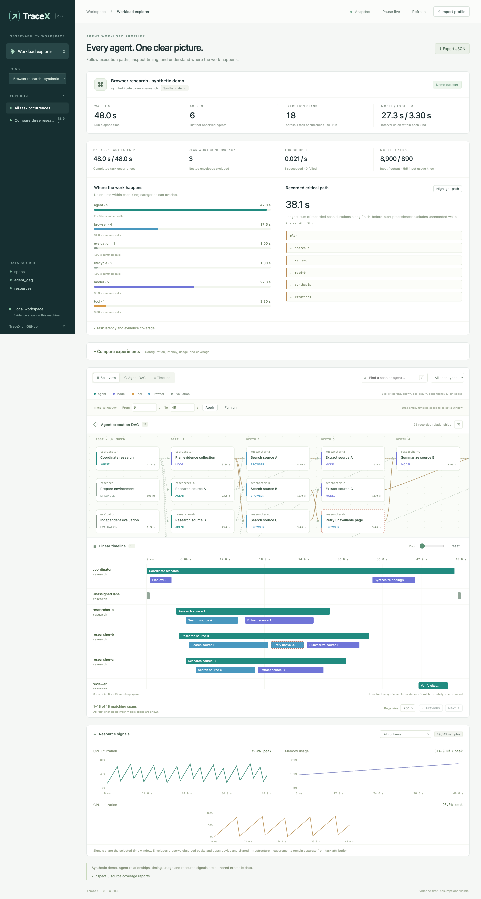

# TraceX

An agent workload profiler for [ARIES](https://github.com/hyscale-lab/ARIES) and backends that emit the TraceX event contract. Explore explicit execution DAGs, a linear timeline, resource signals, critical paths, and experiment comparisons. TraceX is an independent profiler; BrowserBench remains an ARIES workload extension.

The default workspace contains **two synthetic experiments**. Their timing, dependencies, usage, and resource signals are authored examples, not benchmark results.



## Run

Go 1.26 or later is required. The binary embeds the complete UI and uses only the Go standard library. No Node installation, UI build, CDN, or model API is needed to run it.

```sh
git clone https://github.com/aeilot/TraceX.git
cd TraceX
make run
```

Open [http://127.0.0.1:4318](http://127.0.0.1:4318).

Load ARIES runs, normalized JSON, or event streams:

```sh
go run ./cmd/tracex --run /path/to/aries/runs/RUN_ID
go run ./cmd/tracex --run baseline.json --run candidate.json
go run ./cmd/tracex --runs-dir /path/to/aries/runs --watch 1s
go run ./cmd/tracex --run events.jsonl --watch 250ms
go run ./cmd/tracex --run profile.json --watch 0 --addr 127.0.0.1:4319
```

`--run` is repeatable. `--runs-dir` discovers immediate directories and `.json` files at startup; new directories require restarting discovery. Mounted sources update automatically; `--watch 0` disables watching. The browser can pause/resume updates without stopping the source. Binding defaults to loopback; changing the address changes who can access your local data. Stop with Ctrl-C.

Export a complete normalized snapshot, including data outside the current page:

```sh
go run ./cmd/tracex --run /path/to/run --export profile.json
go run ./cmd/tracex --run events.jsonl --export - > profile.json
make build
./bin/tracex --help
```

## Run real experiments

Start with `make run`, open **New experiment → ARIES runner settings**, discover or enter your ARIES directory, select the execution host, and save. The panel can inspect host prerequisites and override external-model settings for each job. Runner settings persist locally across restarts. ARIES must already be checked out and built on the execution host.

Alternatively, configure the runner at startup:

```sh
./bin/tracex --aries-dir /absolute/path/to/ARIES
# macOS, using an existing Linux OrbStack machine:
./bin/tracex --aries-dir /Users/you/Developer/ARIES --aries-executor orb --aries-machine aries-vm
```

Select a workload and profile, choose declared tasks and concurrency, prepare prerequisites, then explicitly start the real benchmark. Runs attach automatically to the live DAG and timeline. The panel supports graceful stop and reports process, harness, evaluation and cleanup outcomes separately. Model execution requires acknowledgment; selecting a preset does not start it. See [experiment setup and limits](docs/experiments.md).

## Explore

- **Experiment workspace:** search mounted and imported runs by name or configuration, filter source state, and select two runs for comparison. Open a run into Overview, Profiler, Insights, Tasks, Configuration, or Evidence. The Tasks table supports search, status filtering and duration/score sorting with direct navigation to the selected task's execution.
- **Restore an investigation:** copy the view link to retain the source run identity, task/span, filters, time window, timeline view window and visualization. The same source must be mounted; browser imports must be reimported after a reload. Sources & runner shows source errors and execution-target readiness. See [workspace behavior and verification](docs/frontend-workspace.md).
- **Agent DAG / timeline / split view:** explicit parent, spawn, call, return, dependency, and multi-parent join relationships. Cyclic graphs are rejected.
- **Analysis:** per-kind interval unions and summed work, task P50/P95, throughput, effective work concurrency, input/output tokens with known-usage coverage, and unobserved task time.
- **Recorded critical path:** longest sum of completed span durations on explicit finish-before-start dependency/join/return edges. Parent containment and unrecorded waits are excluded. Missing or contradictory precedence remains unavailable.
- **Timeline:** every span of the time window, not a page: spans too small to tell apart at the current zoom merge into clusters, and clicking one zooms into it. Drag to pan, ⌘/Ctrl + scroll (or pinch) to zoom about the pointer down to a 1 ms view, and horizontal scroll to pan; lanes show at most 12 rows, with more concurrent spans in a marked overflow row. The DAG draws the first 500 spans of the window.
- **Linked time window:** enter a range or Shift-drag empty timeline space. Spans and CPU/memory/GPU signals share the window. Span details show concurrent resource sample statistics, with runtime/task/shared context labels rather than causal cost claims.
- **Comparison:** choose baseline and candidate runs, inspect configuration differences, latency, throughput, tokens, and evidence coverage. Imported JSON profiles can be compared with mounted sources.
- **Insights:** evidence-linked diagnostics, model/tool aggregates, task-paired regressions, optional explicitly requested LLM interpretation, and a browser-local investigation notebook. See [configuration and metric definitions](docs/insights.md).
- **Configuration sweep:** select several runs and plot task duration P50/P90, model-call P50, browser-tool local work P50/P90 and sandbox throttled-period share against one recorded configuration field (e.g. `concurrency`, `sandbox_cpu_limit`). Optional steady window and indexing to a baseline run. See [experiments](docs/experiments.md#configuration-sweep).
- **Large runs:** server-side filtering, timeline layout per view window and plot width (`/api/timeline`), stable time ordering, overlap indexes, span lookup, and per-runtime resource envelopes that retain observed extrema and missing-value boundaries. Every matching span is drawn or counted in a cluster.
- **Language:** English and Simplified Chinese. The interface follows the browser language; the header switch overrides it and is remembered per browser.
- **Live sources:** incrementally decoded JSONL, partial-line handling, truncation/rotation recovery, last-valid snapshots on malformed updates, and reconnectable server-sent revision notifications.

## Data sources

| Source | Evidence |
| --- | --- |
| ARIES | Task/queue lifecycle, phase events, separate outcomes, sanitized comparison configuration, resource counters, and sandbox paused intervals from `bridge/suspend.jsonl` (`suspended` spans, excluded from work) |
| Hermes | Retained OpenTelemetry spans, explicit parents, selected model usage and identity metadata |
| OpenClaw | Native sessions, explicitly matched tool-call intervals, model completion usage, and bridge evidence |
| BrowserBench | Browser request/page intervals; URL, body, and query content omitted |
| Other backends | Versioned normalized JSON or append-only events |

Older runs cannot recover measurements they never recorded. In particular, a model completion with no start time is displayed as a marker with unavailable duration. Existing ARIES runs show task intervals, while full phase boundaries require the [ARIES instrumentation integration](docs/aries-integration.md). Cross-process clock synchronization is not verified. BrowserBench sandbox timing retains its source-integrity warning.

See [inputs and measurement limits](docs/inputs.md), [schema](docs/schema.md), [event producers](docs/events.md), and [architecture](docs/architecture.md).

## Try a live producer

The included producer emits synthetic lifecycle, branched work, joins, usage, and GPU events. It makes no model or network calls.

```sh
# Terminal 1: create the stream, then emit newline-committed updates.
mkdir -p .cache/live
: > .cache/live/events.jsonl
go run ./examples/producer --interval 300ms >> .cache/live/events.jsonl

# Terminal 2: watch it (start while the producer is running).
go run ./cmd/tracex --run .cache/live/events.jsonl --watch 100ms
```

The producer has a finite demonstration sequence. Restart it by truncating the stream first; TraceX detects the reset. [examples/events.jsonl](examples/events.jsonl) is a complete synthetic fixture.

## Local data

The service exposes normalized summaries and bundled assets. It does not serve run directories or raw logs, execute evidence, or upload runs. After configuring a runner in the UI or with `--aries-dir`, explicitly submitted experiment actions start ARIES, which can call models. Without a runner or optional Insights model configuration, the service only inspects evidence. A configured Insights provider receives only the previewed summary after explicit submission. Prompts, tool arguments, outputs, raw errors, and credentials are excluded by the adapters. Names, IDs, selected metadata, and comparison conditions can still be sensitive; review exports before sharing. Browser imports stay local. Private runs and exports belong outside Git.

## Develop

```sh
make check
```

Node.js 22 or later is needed only for browser-model tests. Checks cover Go tests, JavaScript syntax/model tests, the race detector, vet, and a binary build. See [verification evidence](docs/verification.md) for browser, native-data, streaming, and scale checks.
