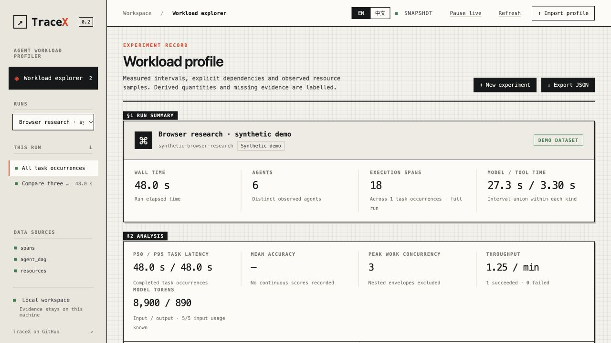
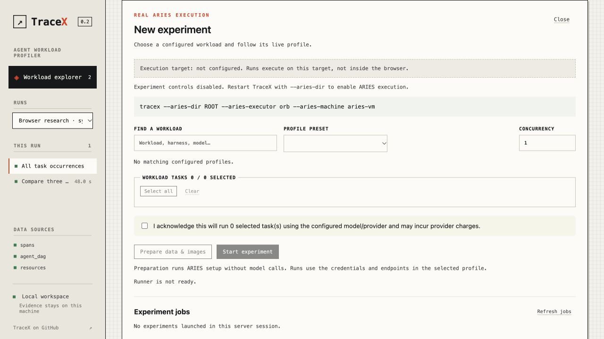
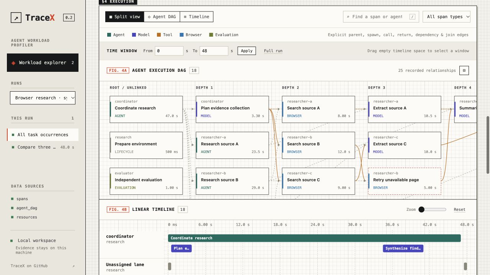
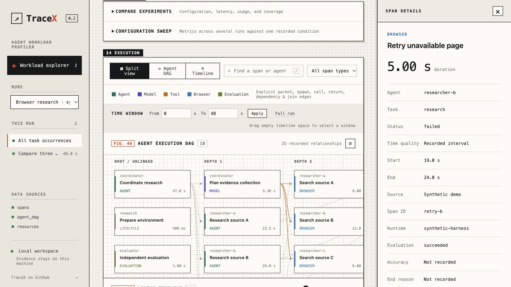
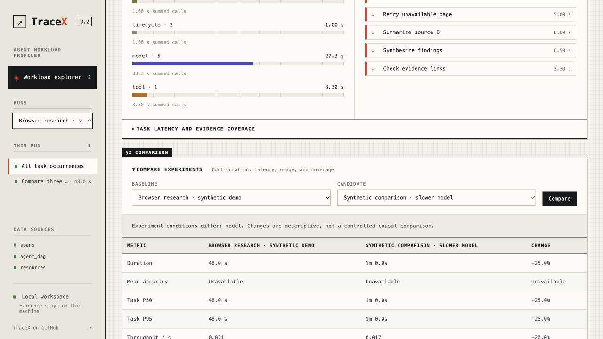

# TraceX 前端审查与 Agent Profiler 平台改造方案

审查日期：2026-10-17。范围：当前 TraceX 工作区源码、当前源码启动的 4320 端口实例、应用内浏览器 1280×720 交互检查。审查产出，不修改产品代码。

## 结论

TraceX 已经有 profiler 的数据处理基础，但前端主要组织成一份纵向实验报告，尚未组织成可以反复「配置 → 执行 → 定位 → 比较 → 复现」的实验工作台。主要问题是任务入口、分析层级和实验状态管理，继续往长页面加卡片会加剧操作负担。

建议产品定位：**面向 Agent 系统开发者的可视化性能实验平台**。首页管理实验，运行详情以时间线为主工作区；DAG 用于解释依赖，资源轨道用于关联观察，比较工作区用于评估配置变化。

## 本次实际检查的流程

| 步骤 | 操作与健康度 | 主要证据 |
| --- | --- | --- |
| 1 | 打开工作区：能加载，但首屏效率低 | 全屏主要是标题、汇总和指标，执行视图不在首屏；run 选择器截断名称 |
| 2 | 打开新建实验：禁用原因可见，恢复路径不完整 | 未配置 runner 时仍展示空表单、0 个任务和费用确认；配置依赖重启命令 |
| 3 | 浏览 DAG / 时间线：基础功能可用，空间与尺度处理较弱 | 18 个 span 的 demo 已需横向滚动；split 是纵向堆叠；多个独立滚动区域 |
| 4 | 点击失败 span：信息可取，但作用域容易误读 | span failed 与 task evaluation succeeded 混在同一列表；详情打开后主图进一步变窄 |
| 5 | 比较两个 run：汇总比较可用，诊断不足 | 展示配置差异与指标百分比，缺少按同一 task 匹配后的回归定位入口 |

### 01 · 首页

优点：demo 标识、缺失值和 usage coverage 有明确表达，指标不是凭空补齐。

问题：用户需要先滚过汇总、分析、关键路径和比较入口才能开始看执行过程。左侧唯一导航是 Workload explorer，没有实验列表或任务结果工作区。标题没有表达当前 run 的具体操作目标。

建议：默认进入实验列表；run 详情采用紧凑摘要 + 独立标签页。把完整来源说明留在 Evidence 页或上下文提示中，同时保留当前指标的覆盖率。

### 02 · 新建实验

优点：没有配置 runner 时阻止执行；准备与模型执行分开。

问题：不可执行状态仍展示大量表单；没有 prerequisites 的逐项状态；用户不能在界面中编辑模型、资源、循环时长等实验变量。配置错误可能到执行阶段才发现。

建议：runner 未配置时显示连接说明与检查结果；配置后进入「选择 workload → 配置变量 → 检查环境 → 核对并启动」。高级变量必须由后端 schema 和 allowlist 校验。先做已配置本地 preset 的安全编辑与复制，不需要立即实现任意远程执行。

### 03 · 执行视图

优点：显式依赖可视化、时间窗口、类型筛选和键盘可聚焦 span 已存在。

问题：DAG 节点尺寸固定，按深度排列；demo 即有图超宽。fit 通过缩小整个 SVG 适配，节点多时文字会非常小。当前分页按开始时间切割 span，跨页边会破坏全图理解。资源区位于更下面，无法直接对齐当前执行轨道观察。

建议：时间线默认；按 task / agent / phase 分组并可折叠；network 请求默认聚合为密度或计数，需要时展开。DAG 默认显示选中 task / span 的邻域，再逐步展开。资源轨道与时间线共享光标和区间。保留分页作为明细表能力，但不要把一页 span 暗示为完整执行拓扑。

### 04 · 详情与失败定位

明确的语义问题：`web/app.js` 的 `inspect` 渲染把 `s.status` 和 `task.evaluation_status` 等 task 字段并列到同一个 definition list。图中失败浏览器 span 下出现成功评价，数值本身可以同时成立，但界面没有解释作用域。

建议拆成「Span 执行」「所属 Task 结果」「并发资源上下文」。详情面板可调宽，打开时保持选中节点可见；支持复制 ID、定位前后关联、固定详情。新增失败/慢任务列表，而不是要求用户逐节点寻找。

### 05 · 比较

优点：展示了非受控配置差异，避免把描述性比较称为因果关系；覆盖率可查看。

问题：比较入口藏在折叠区，与当前 run 的执行浏览混杂；仅从汇总数据难以定位「哪些任务变慢、哪些调用贡献了变化」。已有 configuration sweep 是对已完成 run 作图，不等于自动执行 sweep。

建议独立 Compare：从实验表多选，固定 baseline，按 benchmark task 稳定键匹配，列出缺失任务与不一致条件；增加阶段差异、分布、失败率和质量/性能散点。重复实验有足够样本后再显示误差范围；单次结果不能伪装为稳定结论。

## 按影响排序的问题

| 优先级 | 问题 | 证据与影响 | 验收条件 |
| --- | --- | --- | --- |
| P1 | 一条长页面承载所有任务 | 步骤 1–5；观察、配置和比较互相挤占 | 首屏可进入实验列表、Profiler、Compare；进入 run 后无需滚过报告才看到时间线 |
| P1 | span 与 task 状态作用域混淆 | 步骤 4，app.js 详情字段 | 失败 span 可以属于评价成功的 task，两个作用域必须清楚标识 |
| P1 | 大 run 缺少概览与逐层展开 | 步骤 3；固定节点布局、分页边界 | 先看 task / phase 概览，再下钻；跨页或隐藏边明确标出且可导航 |
| P1 | 资源未返回被标作未测量 | 补充：4318 实例实时 DOM 显示 0/8783 samples、预算超限，同时各图写 Not measured；当前 app.js 也按返回数组缺值决定该标签 | 区分未采集、预算超限、请求失败、筛选后无数据；超限提供直接选择 runtime / 缩短窗口的操作 |
| P1 | 实验历史与运行所有权只在进程内 | docs/experiments.md、Manager.jobs / active | 重启后能恢复实验记录与配置；活动进程需验证后才标记可控制，不自动重启或重跑 |
| P2 | 配置实验能力有限 | experiments.js / Request 仅 profile、tasks、concurrency、action、确认 | 可复制配置，选择 schema 允许的变量，预览最终配置与差异 |
| P2 | 缺少可恢复的调查状态 | app.js state 在内存，未见 URL run / task / span / range 状态恢复 | 复制链接或刷新后恢复 run、task、区间、视图、选中 span；本地导入链接需说明数据仍需重新提供 |
| P2 | 缺少 task 导向的比较 | 步骤 5，compareRuns 汇总表 | 能从回归 task 行直接跳到两次运行的对应 trace |
| P2 | 小字、截断和密集控件 | 所有截图；大量 9–11px 图表与辅助文字 | 重要文本保持可读；缩放后可访问完整名称；小按钮有足够点击面积 |

4318 为本次看到的已有实例，未确认它对应哪个构建；该实例的规模与资源状态仅作补充观察，不作为当前版本功能缺失的唯一依据。没有修改或重启该实例。

## 已有能力与真正缺口

| 领域 | 已有 | 建议补齐 |
| --- | --- | --- |
| 数据 | 多 adapter、JSON/JSONL、ARIES、SSE、校验、coverage | 数据源目录、动态发现/重新扫描、可解释接入状态 |
| 实验 | preset catalog、prepare/start/stop、结果挂载 | 持久化 experiment/run/attempt、标签备注、复制配置、恢复记录 |
| Profiler | DAG、时间线、关键路径、资源区间统计 | 层次轨道、邻域图、统一游标、慢调用/失败列表、URL 状态 |
| 分析 | latency、throughput、usage、accuracy、coverage | 按 task/phase/model/tool 聚合，明确 inclusive 与 exclusive work 的计算口径 |
| 比较 | 两 run 汇总比较、已完成运行 sweep 作图 | task 配对差异、重复实验统计、质量与耗时权衡 |
| 编排 | 单个活动 job、固定允许的 CLI 调用 | 排队、重复次数、参数组合执行、取消未开始项、独立 attempt 状态 |

成本、TTFT、重试次数与原因、模型阶段等待等指标需要数据契约支持。当前不能仅凭前端推导。成本需明确模型版本、价格快照、缓存 token；等待和 self time 需说明嵌套/并行口径；shared CPU/GPU 只能称为同时发生的资源观察，不能直接分摊为 span 成本。

## 建议的信息架构

全局导航：**Experiments · Compare · Sources / Runner**。

运行详情：**Overview · Profiler · Tasks · Configuration · Evidence**。

- Experiments：搜索、标签、状态、配置列、质量/耗时/吞吐、批量选择比较、复制配置再运行。
- Profiler：紧凑 run 头、task/agent 树、主时间线或 DAG、资源轨道、可调整详情面板；统一选择上下文。
- Tasks：按耗时、质量、状态排序，慢任务与失败筛选；从行进入 Profiler。
- Compare：固定 baseline、配置差异、匹配任务回归表、分布与 sweep；点击数据点可追溯 run。
- Sources / Runner：已挂载来源、最新更新时间、解析异常、runner 环境检查与恢复操作。

核心对象：`Experiment`（研究问题、变量、标签）→ `Run`（具体配置和数据来源）→ `Attempt`（执行尝试与进程/清理状态）→ `Task occurrence` → `Span`。这比把 job、run、profile 混称 experiment 更利于复现与重复实验。

## 建议实施顺序

1. **先使现有能力好用。** 拆导航与工作区，建立实验列表和 task 表，时间线首屏可见；修复状态作用域、资源空态、URL 状态；不改变已有分析口径。验收：从列表找到运行→筛出慢 task→查看 span→复制恢复链接，闭环完成。
2. **补实验闭环。** 持久化元数据与配置快照，复制配置，runner 检查，参数 schema，重启后恢复历史；重跑必须显式触发。验收：一份配置可产生两次可追溯 attempt，服务重启仍可查看历史和证据。
3. **补研究与诊断。** task 配对比较、阶段差异、质量/性能图、重复实验与 sweep 队列。验收：配置多个 concurrency 值和重复次数，逐次执行并记录失败/取消，结果可回溯原始 run；缺少测量的指标保持 unavailable。

技术上先保留 Go API、数据适配器和静态嵌入方式。当前 `app.js` 同时负责状态、请求、分析展示、图表和详情，`styles.css` / `experiments.css` / `lab.css` 分层覆盖；应先按 workspace、profiler、compare、runner 分模块并集中 tokens。是否引入 React/TypeScript 应由复杂交互与维护成本决定，不应成为修复信息架构的前置条件。

## 无障碍与检查边界

截图可见的小字、低强调文字、颜色分类和密集按钮存在可读性风险；未做对比度数值测量，不宣称 WCAG 不合规。源码已有 focus-visible、部分 aria label、SVG span 的 Enter/Space 支持，应保留。完整键盘轨迹、详情焦点迁移、屏幕阅读器、200% 缩放与移动端仍需专项检查。

本次实际点开了新建实验、失败 span 和比较；保存并检查了五张截图。未启动真实模型、准备数据、取消任务或修改外部服务；未验证 runner ready 后的真实执行闭环。未运行测试套件，因为本次只新增审查文档与截图，没有修改产品逻辑。真实数据的量级问题需要后续在对应运行上做针对性的交互与性能验证。
